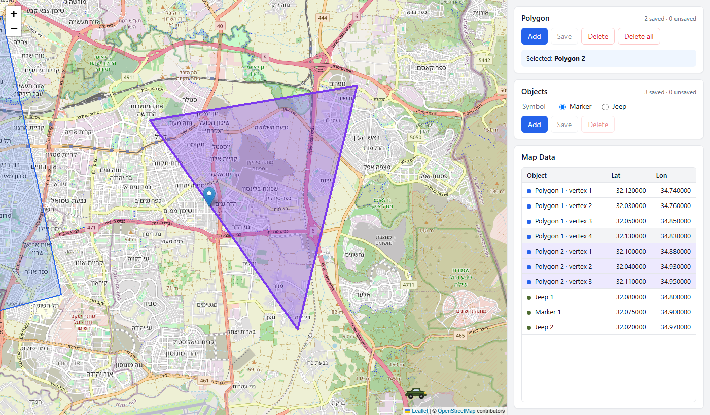

# Map Application (Client / Server)

Manage geographic objects (polygons and markers / custom symbols) on an interactive map.

| Layer    | Technology                                                    |
|----------|---------------------------------------------------------------|
| Client   | React 19 + TypeScript, Vite, Leaflet / react-leaflet          |
| Server   | ASP.NET Core 9 Web API (controllers)                          |
| Database | MongoDB 8 — data stored as GeoJSON with `2dsphere` indexes    |



Architecture diagrams (deployment, components, save sequence, coordinate flow, client state):
[docs/ARCHITECTURE.md](docs/ARCHITECTURE.md).

## Quick start

### Everything in Docker

```bash
docker compose up --build
```

Open **http://localhost:8080**. The API is also exposed directly on http://localhost:5080.

### Local development

Prerequisites: .NET SDK 9, Node.js 20+, Docker (only for MongoDB).

```bash
docker compose up -d mongo                         # MongoDB on localhost:27017

cd server/MapApp.Api && dotnet run                 # API on http://localhost:5080

cd client && npm install && npm run dev            # UI on http://localhost:5173 (proxies /api to :5080)
```

### Tests

```bash
cd server && dotnet test        # validator, services, HTTP contract (in-memory) + MongoDB integration (Docker)
cd server && dotnet test --filter "Category!=Integration"   # without Docker
cd client && npm test           # geometry / mapping unit tests (Vitest)
cd client && npm run lint
```

## Using the application

The screen has four panels: **Map** (left), **Polygon**, **Objects** and **Map Data** (right).

**Polygon**
- **Add** – enters drawing mode. Click the map to add vertices; click the first vertex again to close the polygon
  (needs at least 3 vertices). `Backspace` removes the last vertex, `Esc` cancels.
  Self-intersecting shapes cannot be closed.
- **Save** – sends all unsaved polygons to the server (`POST`). The server responds with the saved polygons,
  which are added to the map and the Map Data table.
- **Delete** – deletes the selected polygon (click it on the map or in the table).
  **Delete all** – deletes every polygon from the map and the database. Both ask for confirmation.

**Objects**
- Choose the symbol (**Marker** or **Jeep**) and click **Add**, then click the map to place it.
  Unsaved objects can be dragged.
- **Save** – sends the list of unsaved objects (`POST`); the table is refreshed from the response.
- **Delete** – deletes the selected object (click it on the map or in the table).

**Map Data** – `Object / Lat / Lon` for everything stored in the database: one row per object and one row per polygon
(its Lat / Lon is the polygon's center). The ▸ button expands a polygon's vertices underneath it. The table reflects
the server state, so it changes after Save / Delete. Clicking a row selects the item and zooms to it; clicking a vertex
zooms to that vertex.

Unsaved items are drawn dashed / semi-transparent, and the browser warns before leaving the page while any exist.

## REST API

All geometries are GeoJSON, positions are **`[longitude, latitude]`**. Errors use RFC 7807 problem details
(`application/problem+json`); validation errors list the offending item, e.g. `"[1].geometry.coordinates"`.

| Method   | Route                 | Body / result                                                                  |
|----------|-----------------------|--------------------------------------------------------------------------------|
| `GET`    | `/api/polygons`       | `200` list of polygons                                                         |
| `GET`    | `/api/polygons/{id}`  | `200` polygon, `404`                                                           |
| `POST`   | `/api/polygons`       | array of `{ name?, clientId?, geometry: Polygon }` → `200` **the saved items**, `400` |
| `DELETE` | `/api/polygons/{id}`  | `204`, `404`                                                                   |
| `DELETE` | `/api/polygons`       | `204` (delete all)                                                             |
| `GET`    | `/api/objects`        | `200` list of objects                                                          |
| `GET`    | `/api/objects/{id}`   | `200` object, `404`                                                            |
| `POST`   | `/api/objects`        | array of `{ name?, clientId?, symbol: "marker" \| "jeep", geometry: Point }` → `200` the saved items, `400` |
| `DELETE` | `/api/objects/{id}`   | `204`, `404`                                                                   |
| `DELETE` | `/api/objects`        | `204` (delete all)                                                             |
| `GET`    | `/health/live`        | `200` while the process is running (liveness)                                  |
| `GET`    | `/health/ready`       | `200` when MongoDB is reachable, otherwise `503` (readiness)                   |

The `2dsphere` indexes are created during startup, before the server starts listening, so no request can store a
geometry before MongoDB is able to validate it.

Example (`server/MapApp.Api/MapApp.Api.http` has more):

```http
POST /api/objects
Content-Type: application/json

[{ "name": "Jeep 1", "symbol": "jeep", "geometry": { "type": "Point", "coordinates": [34.79, 32.07] } }]
```

Stored document (`mapObjects` collection):

```json
{ "_id": ObjectId("…"), "name": "Jeep 1", "symbol": "Jeep",
  "location": { "type": "Point", "coordinates": [34.79, 32.07] }, "createdAt": ISODate("…") }
```

## Project structure

```
server/
  MapApp.Api/
    Controllers/      PolygonsController, ObjectsController (thin HTTP layer)
    Services/         PolygonService, MapObjectService (validation + mapping), GeoJsonMapper
    Validation/       GeometryValidator (ranges, ring closing/orientation, self-intersection)
    Data/             IRepository<T>, MongoRepository<T>, 2dsphere index initializer, BSON conventions
    Models/           MongoDB documents (GeoJSON object model)
    Contracts/        API DTOs (plain GeoJSON)
    Infrastructure/   DI registration, exception → problem-details mapping
  MapApp.Api.Tests/   xUnit: validator, services, HTTP contract (WebApplicationFactory)
client/
  src/
    api/              fetch wrapper with error handling, REST clients
    hooks/            useEditableCollection — saved items, drafts, selection, save/delete
    map/              MapView, DrawingLayer (polygon drawing), icons (Marker / Jeep SVG)
    panels/           PolygonPanel, ObjectsPanel, MapDataPanel
    geo.ts            pure helpers: lat/lng ↔ GeoJSON, polygon validity, table rows
```

## Design decisions

- **GeoJSON end to end.** MongoDB stores `Polygon` / `Point` geometries with `2dsphere` indexes, and the API uses the
  same shape. Conversion between Leaflet's `{lat, lng}` and GeoJSON `[lng, lat]` happens in one place on each side
  (`geo.ts`, `GeoJsonMapper`), which prevents swapped-axis bugs.
- **Server is the source of truth.** The table renders only server data. Save returns the saved items ("Return
  updated data": confirmed with the reviewer to mean the items of that request, not the whole collection), and the
  client merges them into its list by id.
- **Live updates (Server-Sent Events).** Other users' changes appear without a page reload. After every write the
  server sends a tiny event on `GET /api/events` (`event: changed`, `data: polygons|objects`); the client then
  reloads that collection with the normal GET. Events carry no data; the server keeps, per client, only the set of
  collections changed since its last event (repeated changes merge, none can be dropped), and every time the stream
  opens, the first time included, the client reloads everything, so a change made before it was listening is not
  missed. SSE was chosen over polling (delay,
  needless requests) and WebSocket/SignalR (two-way channel not needed). A heartbeat every 15 s keeps proxies from
  closing the stream; the stream ends on shutdown, so the API still stops gracefully.
- **Batch save is all-or-nothing, best effort.** The whole batch is validated before writing. If MongoDB still rejects
  a document, the already-written part of the batch is deleted again (a compensating action: a standalone MongoDB has
  no multi-document transactions, so this is not a transaction — a crash or a lost connection mid-write can leave
  part of a batch).
- **Retrying a Save is safe.** Each item carries `clientId`, the draft's random id, used as an idempotency key: the
  server upserts by it (`$setOnInsert`, unique index), so sending the same drafts again after a lost response stores
  nothing twice. A `clientId` repeated inside one batch is rejected with 400.
- **Geometry validation** mirrors what the `2dsphere` index accepts: valid ranges, ≥ 3 distinct vertices, no crossing
  or touching edges, non-zero area. Rings may be sent open or closed; the server closes them and orients them
  counter-clockwise (RFC 7946), keeping the first vertex. The client runs the same check before closing a polygon.
  Limits: at most 1000 distinct vertices per polygon and 10 000 positions per request (the self-intersection check
  is O(n²), so one request stays cheap).
- **Indexes before traffic.** The `2dsphere` and `clientId` indexes are created during startup, before the server
  starts listening. If MongoDB is not reachable yet, startup retries for up to a minute; invalid stored data, a
  conflicting index or wrong credentials stop the startup with a clear message. Later database outages return
  `503` instead of hanging (5 s server-selection timeout).

## Known limitations

- Polygons crossing the antimeridian (±180°) are not supported: Leaflet would draw them the long way round.
- Polygons with holes and multi-polygons are not supported (the drawing tool produces simple polygons only).
- Self-intersection is checked in planar lon/lat space; for very long edges MongoDB's geodesic check may differ.
  The API then returns a `400` with a clear message.
- No authentication — out of scope for the task.
- Live updates reach the clients connected to the API instance that handled the write. Several API instances would
  need a shared channel (Redis pub/sub or MongoDB change streams); deployment is out of scope.
