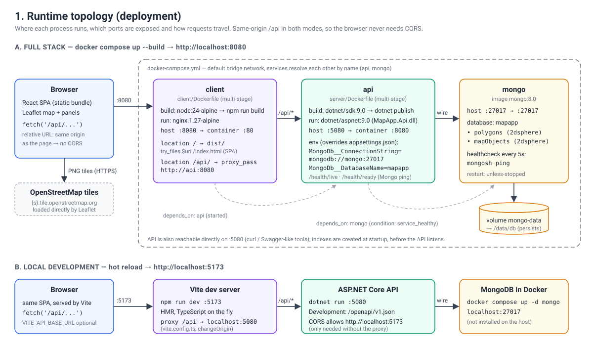
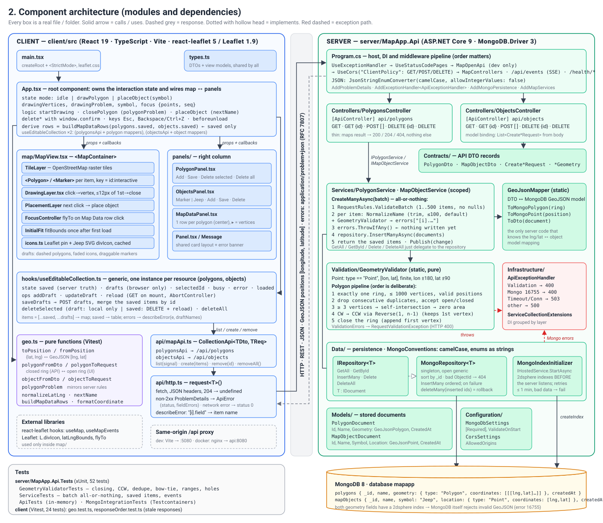
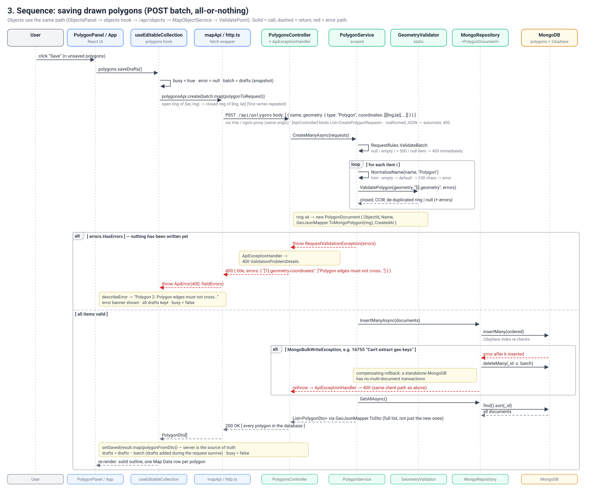
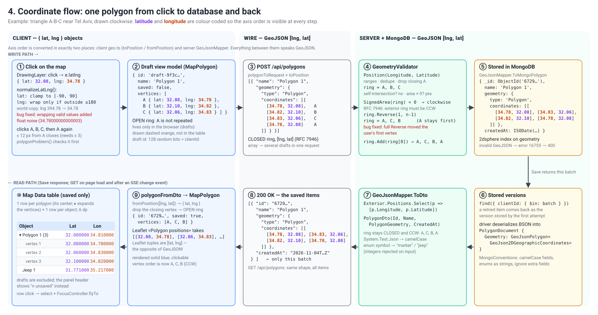
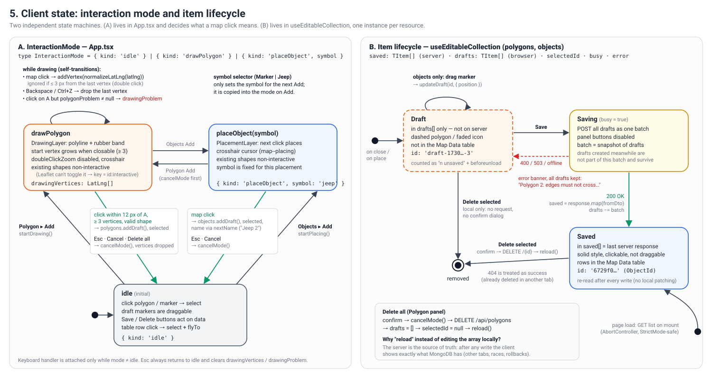

# Architecture

This document explains how the Map Application is put together: where each part runs, how the modules
depend on each other, and what happens to the data on its way from a map click to MongoDB and back.
Every box in the diagrams is a real file or folder in the repository.

| # | Diagram | Answers the question |
|---|---------|----------------------|
| 1 | [Runtime topology](#1-runtime-topology) | What runs where, on which ports, and how does a request reach the database? |
| 2 | [Component architecture](#2-component-architecture) | Which module calls which, and what is each one responsible for? |
| 3 | [Save sequence](#3-save-sequence) | What exactly happens when the user presses **Save**, including the failure cases? |
| 4 | [Coordinate flow](#4-coordinate-flow) | How do coordinates change shape and axis order between Leaflet, JSON and MongoDB? |
| 5 | [Client state](#5-client-state) | What does a map click mean right now, and how does an item go from draft to saved to deleted? |

---

## 1. Runtime topology

- **Three containers** in `docker-compose.yml`: `client` (nginx serving the built SPA), `api` (ASP.NET Core 9)
  and `mongo` (MongoDB 8 with a named volume).
- **Same-origin API.** The browser always calls the relative path `/api/...`. In Docker, nginx proxies `/api/`
  to `http://api:8080`; in development, the Vite dev server proxies it to `localhost:5080`. The browser
  therefore never makes a cross-origin request. CORS is still configured on the API for the case where the
  client is served from a different origin (`Cors:AllowedOrigins`).
- **Indexes before traffic.** `MongoIndexInitializer` is an `IHostedService`, and the host awaits its
  `StartAsync` before the web server starts listening. So the `2dsphere` indexes always exist before the first
  request, and no geometry can be stored before MongoDB is able to validate it. `createIndex` is idempotent,
  so this runs on every start and on every instance.
- **Transient and permanent errors.** If MongoDB is not reachable yet, the initializer retries with exponential
  back-off (1 s up to 16 s) for up to a minute; the port stays closed meanwhile. If the index cannot be built at
  all (invalid stored data: 16755; conflicting index definition: 85, 86; 67), retrying cannot help, so the
  startup fails with a clear message and Docker restarts the container (`restart: unless-stopped`). In
  docker-compose, `api` also waits for `mongo` to pass its health check.
- **Configuration** comes from `appsettings.json` and is overridden by environment variables
  (`MongoDb__ConnectionString`, `MongoDb__DatabaseName`). `MongoDbSettings` is validated on start-up.
- **Health checks.** `GET /health/live` reports that the process is up and does not touch MongoDB, so a
  database outage never makes an orchestrator restart the API. `GET /health/ready` returns 200 when MongoDB
  answers a ping. nginx does not proxy `/health`, so it is not public.
- Map tiles are loaded by Leaflet directly from OpenStreetMap. They do not go through our server.

## 2. Component architecture

### Client (`client/src`)

| Layer | Files | Responsibility |
|-------|-------|----------------|
| Composition | `App.tsx` | Owns the interaction mode, the polygon being drawn and the map focus. Wires the map and the three panels together. Asks for confirmation before deleting. Handles keyboard shortcuts and warns about unsaved drafts before the page is closed. |
| View | `map/*`, `panels/*` | Presentational components. They get data and callbacks through props and do not call the API themselves. |
| State | `hooks/useEditableCollection.ts` | Generic hook, used once for polygons and once for objects. Keeps `saved` (what the server returned), `drafts` (browser only), the selection, a busy flag and the last error. |
| Pure logic | `geo.ts` | Axis-order conversion, DTO ↔ view-model mapping, the client-side copy of the polygon validity rules, Map Data rows. No React and no I/O, so it is unit-tested. |
| Transport | `api/mapApi.ts`, `api/http.ts` | One generic `CollectionApi` for both resources. `request<T>()` turns RFC 7807 problem responses into `ApiError`. `describeError` maps `"[i].field"` errors to the name of the draft that caused them. |

### Server (`server/MapApp.Api`)

| Layer | Files | Responsibility |
|-------|-------|----------------|
| Host | `Program.cs`, `Infrastructure/ServiceCollectionExtensions.cs` | DI registration, middleware order, JSON options (enums as camelCase strings, integers rejected), ProblemDetails, CORS, OpenAPI in Development, `/health/live` and `/health/ready`. |
| HTTP | `Controllers/*`, `Contracts/*` | Thin controllers that only map results to 200, 204 or 404. The DTOs are plain GeoJSON. |
| Application | `Services/*` | `CreateManyAsync` validates the whole batch first, then inserts it, then returns the full list. `GeoJsonMapper` is the only server code that converts between the DTOs and the MongoDB GeoJSON types. |
| Domain rules | `Validation/*` | `GeometryValidator` is static and pure: it checks coordinate ranges, dedupes vertices, accepts open or closed rings, rejects self-intersections and zero area, and turns the ring counter-clockwise. Errors are collected per path and thrown as one `RequestValidationException`. |
| Errors | `Infrastructure/ApiExceptionHandler.cs` | Validation errors and MongoDB error 16755 ("can't extract geo keys") become 400. A timeout or connection failure becomes 503. Anything else becomes a 500. |
| Persistence | `Data/*`, `Models/*` | `IRepository<T>` is implemented by `MongoRepository<T>`. When an insert of several documents fails part-way, the repository deletes the ones already written (compensating rollback). BSON conventions: camelCase names and enums stored as strings. |

**Dependency direction:** controllers → services → validation / mapper → repository → MongoDB. Nothing points
back up. Because the services depend on `IRepository<T>` and not on MongoDB, the API tests replace it with
`InMemoryRepository` through `WebApplicationFactory<Program>` and run without a database.

## 3. Save sequence

Things to notice:

1. **The whole batch is validated before anything is written.** If any item is invalid, nothing is stored and
   the response lists every problem, keyed by `"[index].field"`. The client uses the index to name the
   draft ("Polygon 2: …").
2. **Best-effort atomicity, not a transaction.** A standalone MongoDB server has no multi-document
   transactions. If MongoDB still rejects a document (for example, the `2dsphere` index rejects a geometry with
   error 16755), the repository deletes the documents of the batch that were already inserted and rethrows.
   This compensating action can itself fail, and a crash or lost connection mid-write can leave part of a batch.
   A real transaction needs a replica set.
3. **Retrying is idempotent.** Each item carries `clientId` (the draft's random id). The repository upserts by
   it with `$setOnInsert`, backed by a unique partial index, so repeating a Save whose response was lost does
   not create duplicates.
4. **The server is the source of truth.** Save returns the full list, not only the new items, and the client
   replaces its `saved` array with it. Delete calls `reload()`. The client never patches its local copy by
   hand.
5. **Drafts created during the request are kept.** The hook sends a snapshot of the drafts and, on success,
   removes only the drafts that were in that snapshot.

Objects follow the same path: `ObjectsPanel` → objects hook → `POST /api/objects` → `MapObjectService` →
`GeometryValidator.ValidatePoint`.

## 4. Coordinate flow

- **Two axis orders exist.** Leaflet uses `{ lat, lng }` objects and `[lat, lng]` tuples. GeoJSON
  (RFC 7946) and MongoDB use `[longitude, latitude]`. The order is converted in exactly two places:
  `geo.ts` (`toPosition` / `fromPosition`) on the client and `GeoJsonMapper` on the server.
- **Open and closed rings.** The UI works with an open ring, where the first vertex is not repeated. GeoJSON
  requires a closed ring. `polygonToRequest` closes the ring, the server accepts either form, and
  `polygonFromDto` opens it again.
- **Orientation.** RFC 7946 requires the exterior ring to be counter-clockwise. If the user drew it clockwise,
  the server reverses every vertex except the first (`Reverse(1, n-1)`), so the user's first vertex stays
  first.
- **World copies.** When the user clicks on a repeated copy of the world, Leaflet can report a longitude
  outside ±180. `normalizeLatLng` wraps it back into range, and only when it is out of range, so valid values
  are not changed by floating-point noise.

## 5. Client state

- **(A) Interaction mode.** This decides what a map click does: nothing special (`idle`), add a vertex
  (`drawPolygon`), or place an object (`placeObject`). While drawing or placing, the existing shapes are
  made non-interactive so that clicks reach the map. Leaflet cannot change `interactive` on an existing
  layer, so it is part of the React `key`, which makes React recreate the layer.
- **(B) Item lifecycle.** A new item is a **draft** that exists only in the browser. **Save** sends all drafts
  of one kind in one request. Deleting a draft only removes it locally, with no request and no confirmation.
  Deleting a saved item asks for confirmation, sends `DELETE` and reloads the list from the server. The Map
  Data table shows saved items only, and the panel header shows how many items are unsaved.

---

## Known limitations

- Polygons that cross the antimeridian, polygons with holes and multipolygons are not supported.
- The self-intersection check is planar (longitude/latitude). MongoDB uses geodesic edges, so the two can
  disagree on very long edges. If MongoDB rejects a geometry, the user still gets a 400 response.
- There is no authentication.
